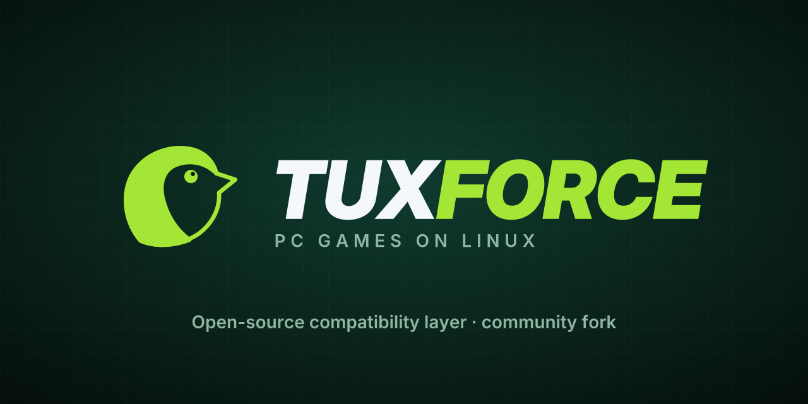

<p align="center"></p>

# tux-force.github.io

The website of [Tux-Force](https://github.com/Tux-Force): guide, compatibility list, downloads, news and the project
documents (vision, roadmap, plans, brand). Published at **https://tux-force.github.io**.

Built with [Astro Starlight](https://starlight.astro.build) and the
[starlight-blog](https://github.com/HiDeoo/starlight-blog) plugin.

## Working on it

```bash
npm ci
npm run dev      # http://localhost:4321
npm run build    # static site in dist/
```

| Path | Contents |
|---|---|
| `src/content/docs/` | Pages in Markdown/MDX: `guide/`, `project/`, `blog/`, `compatibility.mdx`, `downloads.mdx` |
| `src/data/compatibility.json` | The compatibility list |
| `src/styles/brand.css` | Brand colours mapped onto Starlight |
| `brand/` | Logo sources and build tools; exports are in `public/brand/` |
| `astro.config.mjs` | Navigation, logo, plugins, locales |

English only for now; a German translation goes into `src/content/docs/de/` with a `de` locale in `astro.config.mjs`.

Changes go through pull requests to `develop`; merging `develop` into `main` publishes the site (see
[Contributing](https://tux-force.github.io/project/contributing/)).

> Unofficial community project. Not affiliated with, endorsed by, or sponsored by Microsoft or Xbox. The brand assets
> are © Tux-Force.
